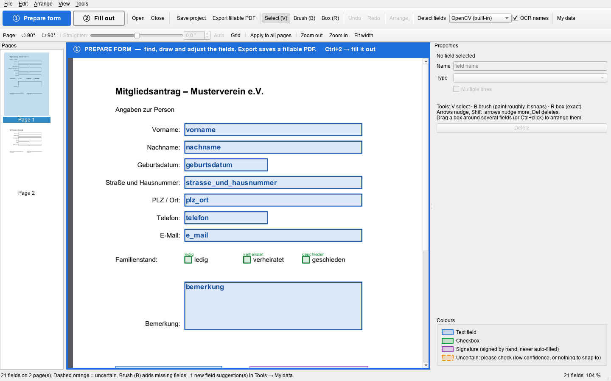
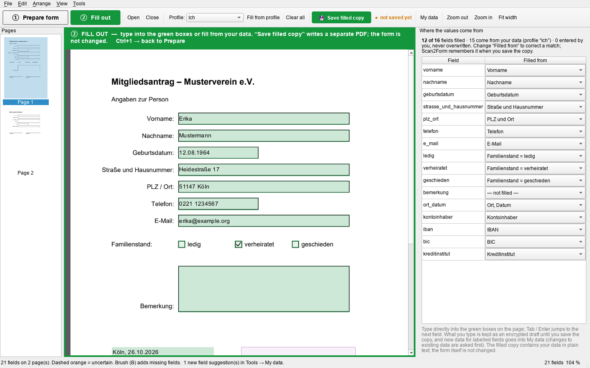

# Scan2Form

[](https://github.com/Baumfaust/scan2form/actions/workflows/ci.yml)
[](LICENSE)

Turn scanned or flat paper forms into fillable PDFs (AcroForms), then fill them out from your
own data. 100 % offline: no cloud, no account, no telemetry. Early development, Windows first.

| ① Prepare: fields detected and named from their labels | ② Fill out: pre-filled from your encrypted data |
|---|---|
|  |  |

<sub>Screenshots of a fictitious demo form with made-up data.</sub>

- **Detects fields** on scans and PDFs (text lines, boxes, checkboxes, signatures) and **names
  them from the printed labels** (German and English OCR, all on your PC).
- **Straightens crooked scans** automatically, with manual fine-tuning.
- **Review canvas** to fix, add (paint roughly, it snaps) and line up fields.
- **Exports a standard fillable PDF** that works in any PDF viewer.
- **Fills out any fillable PDF** — also third-party forms — from an encrypted store of your data,
  and writes a separate filled copy.

## Download (Windows)

Get `Scan2Form-<version>-windows-x64.zip` from the
[latest release](https://github.com/Baumfaust/scan2form/releases/latest), unzip it anywhere and
start `Scan2Form.exe`. No installation, no account; the OCR models are included, so it never
needs an internet connection. The app is not code-signed yet, so Windows may warn about an
unknown publisher (*More info → Run anyway*). What changed: [CHANGELOG](CHANGELOG.md).

## Run from source

Requires [uv](https://docs.astral.sh/uv/) (it brings Python 3.12 along).

```sh
git clone https://github.com/Baumfaust/scan2form.git
cd scan2form
uv sync
uv run scan2form-gui [form.pdf]
```

From source, `rapidocr` downloads its two PP-OCRv5 models (text detection and Latin recognition,
about 13 MB) once on the first OCR run; after that everything runs offline.

## Using the app

The app has two modes, switched with the big buttons top left (Ctrl+1 / Ctrl+2). A coloured
banner, frame and the window title always show which one is active.

### ① Prepare form (blue)

Open or drop a PDF or scanned image (PNG, JPG, TIFF …); fields are detected and named
automatically. The name of each field is shown inside its box; the colour shows its type
(the key is at the bottom of the *Properties* panel):

| Colour | Meaning |
|---|---|
| Blue | Text field |
| Green | Checkbox |
| Purple | Signature — signed by hand, never filled automatically |
| Orange, dashed | Uncertain detection, worth checking |

| Key | Tool / action |
|---|---|
| V | Select: drag to move, handles to resize, arrows nudge (Shift = more), Del deletes |
| B | Brush: paint roughly over a missing field; it snaps to the printed line, box or checkbox. A click on a checkbox adds it |
| R | Box: draw an exact rectangle |
| U | Make uniform: select several fields (drag a box around them or Ctrl+click), then give them the same size and align them as a column or row. More in the *Arrange* menu |
| G | Grid (10 mm) to check the straightening |
| Ctrl+Z / Ctrl+Y | Undo / redo |
| Ctrl+S | Save project (`*.s2f.json`: the field layout, never any filled-in values) |
| Ctrl+E | Export fillable PDF (`*.fillable.pdf`; the original is never overwritten) |

- **Names:** change a field's name in the *Properties* panel. Fields with the same label on
  several pages ("Vorname" on page 1–3) are **one linked field**: filled once, shown everywhere.
  Give a text field the name of another to link them, a different name to unlink.
  *Edit → Link repeated fields across pages* merges older `vorname_2`, `vorname_3` ….
- **Crooked or sideways scans** are straightened automatically on import. The *Page* toolbar turns
  a page by 90° (Ctrl+Shift+← / →), fine-tunes the angle (± 10°, with the grid), re-measures it
  (*Auto*) or copies the orientation to all pages. Fields move along. On export, scanned pages are
  written straightened at their original scan resolution; digital PDFs are never rasterised and
  only turn in lossless 90° steps.

### ② Fill out (green)

Type directly into the green boxes on the page; Tab / Enter jumps to the next field. Fields are
pre-filled from your data (*Tools → My data*), signature dates with today's date.

| Key | Action |
|---|---|
| Ctrl+S | 💾 Save filled copy (`*.filled.pdf`); afterwards Ctrl+S updates that same copy |
| Ctrl+Shift+S | Save filled copy as … |
| Ctrl+Shift+P | Fill from profile (the profile is picked in the toolbar) |

- Next to the save button you see **"● not saved yet"** or **"✓ saved: …"**.
- Values you typed are **never overwritten** by *Fill from profile*; to replace one, delete it or
  pick its source in the side panel (*Filled from*).
- **Nothing typed is lost:** entries are kept as an encrypted draft until the copy is saved and
  come back when you open the form again — also after a crash.
- PDFs that are **already fillable** (also third-party forms) open straight in this mode with
  their own fields and values. While you don't change the fields, the original is filled as it is
  (radio groups, dropdowns and formatting stay); fields changed in Prepare replace the old ones on
  export instead of adding duplicates.
- All filled text uses one font size (10 pt on paper), shrinking only where a value would not fit.

### Files

*File → Open Recent* lists the last 10 forms and projects (Alt+F, R, 1…9), *File → Close*
(Ctrl+W) returns to the start screen. Three kinds of files, each saved by its own command:

| File | Saved by | Contains |
|---|---|---|
| `form.s2f.json` | Save project (① Prepare) | Field layout, names, page orientation — no personal data |
| `form.fillable.pdf` | Export fillable PDF (① Prepare) | The blank form with fields |
| `form.filled.pdf` | Save filled copy (② Fill out) | The form with your data |

## My data & privacy

**Tools → My data** stores personal data (name, address, birth date, bank details, own custom
fields) in profiles such as "Ich", "Partner", "Kind".

- Fields are matched by label (German/English synonyms, e.g. "Geburtsdatum (TT.MM.JJJJ)",
  "PLZ / Ort", "Ort, Datum", "Datum der Unterschrift"); combined values (full name, PLZ + Ort,
  Ort + today's date) are computed.
- **It learns from you:** new data typed into a labelled field goes into *My data* when you leave
  the box; changing data that is already stored is confirmed once when you save the copy. A
  different *Filled from* choice is remembered for every form with that label.
- Labelled fields that match nothing show up as suggestions in *My data*.
- **Import** `Label: value` lines (text/Markdown, e.g. `- **Vorname:** Erika`) with *My data →
  Import from file…* or on the command line (prints field names only, never values):
  `uv run python -m scan2form.core.autofill.importer data.md [--profile Ich]`.
  Unknown labels become custom fields; a combined street + house number is split.
- The data file (`%LOCALAPPDATA%\Scan2Form\vault.s2fv`, including drafts) is AES-256-GCM
  encrypted; its key lives in the OS credential store (Windows Credential Manager), so it opens
  with your login only. Nothing is ever sent anywhere. Filled PDFs contain the data in plain
  text, as any filled form does.

## Command line

```sh
uv run scan2form form.pdf -o form.fillable.pdf          # also accepts PNG/JPG/TIFF scans
uv run scan2form form.pdf --no-ocr --project fields.json
```

Pipeline: render → straighten → field detection → OCR (German/English) → naming from nearby
labels → AcroForm export.

## Development

```sh
uv sync                      # core + dev tools
uv run pytest
uv run ruff check src tests tools && uv run ruff format --check src tests tools
uv run scan2form-spike <folder-with-forms>                    # detector comparison
uv run python -m scan2form.spike.import_markup form.pdf shot*.png   # red-pen marks -> ground truth
uv run python tools/make_icon.py                              # regenerate the app icon (PNGs + .ico)
uv run python tools/make_screenshots.py                       # README screenshots (demo form, fake data)
```

Windows package (PyInstaller, one folder with the OCR models; runs the packaged app's
`--self-test` and zips it to `dist/`):

```sh
uv sync --group build
uv run python tools/build_windows.py
```

Pushing a tag `v*` builds the same package on GitHub Actions and publishes it as a release with
the matching [CHANGELOG](CHANGELOG.md) section. Contributions: see [CONTRIBUTING](CONTRIBUTING.md).

Optional FFDNet comparison (local evaluation only, never shipped: Ultralytics is AGPL-3.0 and the
CommonForms/FFDNet weights have no license yet):

```sh
uv sync --group ffdnet-eval
uv run scan2form-spike <folder> -d opencv,ffdnet-s,ffdnet-l
```

Real-world test forms go in `local_tests/`, which is gitignored and never shared.

## License

Scan2Form is free software under the **GNU General Public License v3.0 or later** — see
[LICENSE](LICENSE). You may use, study, share and change it; modified versions you distribute
must stay under the GPL with their source available.

Third-party components (all compatible with the GPL-3.0):

| Component | License |
|---|---|
| PySide6 / Qt for Python | LGPL-3.0 (also offered under GPL-2.0/3.0) |
| RapidOCR + PP-OCR models | Apache-2.0 |
| OpenCV (opencv-python-headless) | Apache-2.0 |
| ONNX Runtime | MIT |
| pypdf | BSD-3-Clause |
| pypdfium2 / PDFium | Apache-2.0 / BSD-3-Clause |
| cryptography | Apache-2.0 or BSD-3-Clause |
| keyring, platformdirs | MIT |
| Pillow | MIT-CMU |
| NumPy | BSD-3-Clause |

No AGPL code is part of the app; the optional FFDNet comparison above is for local evaluation only.
